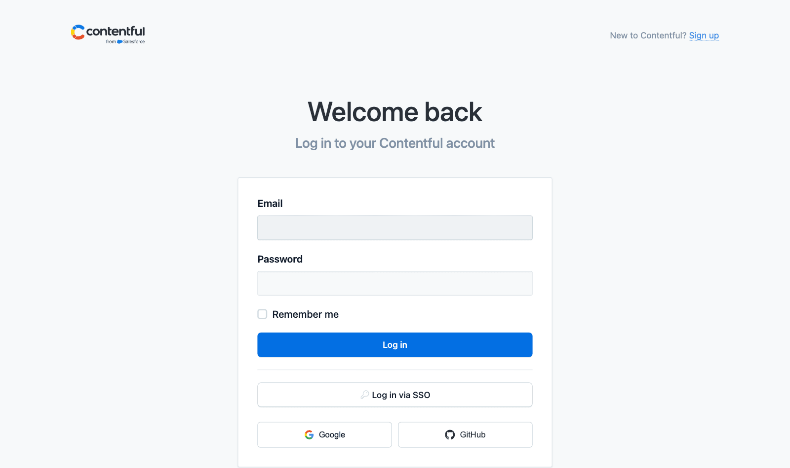
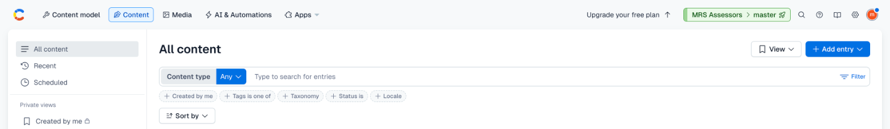
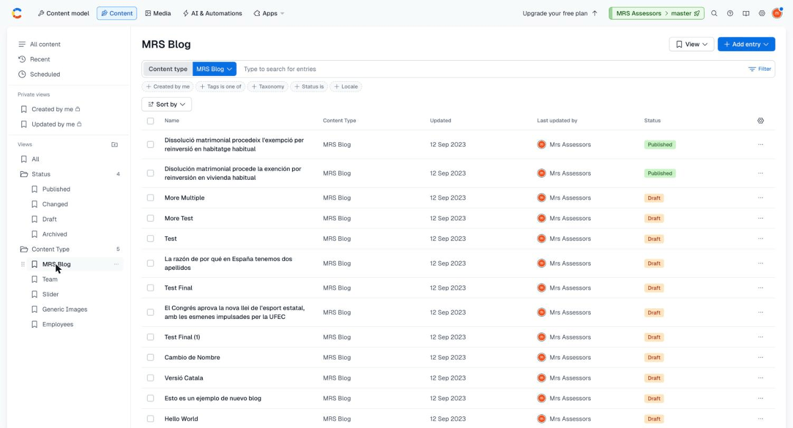
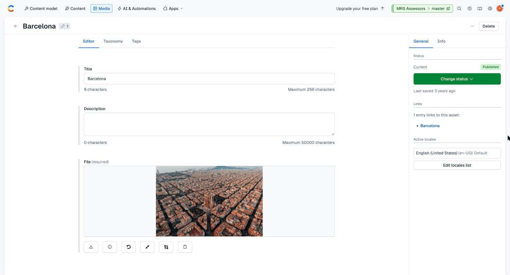
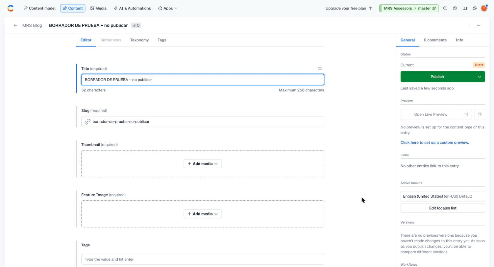
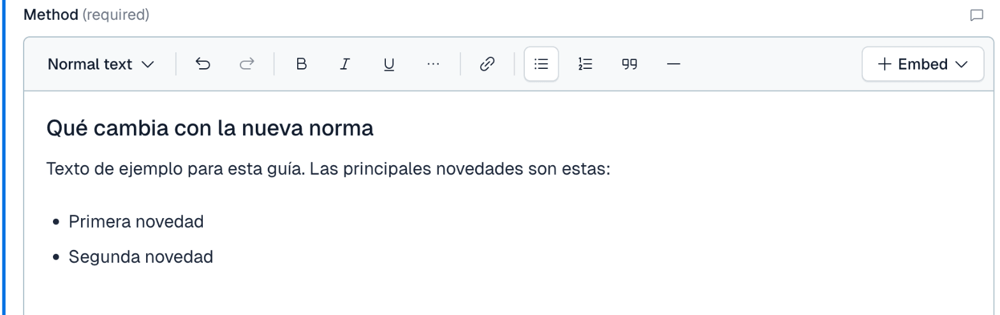
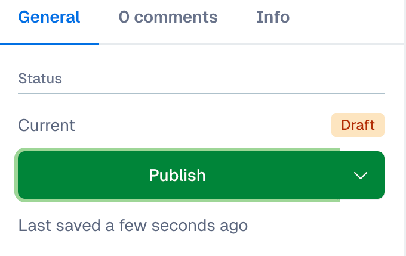
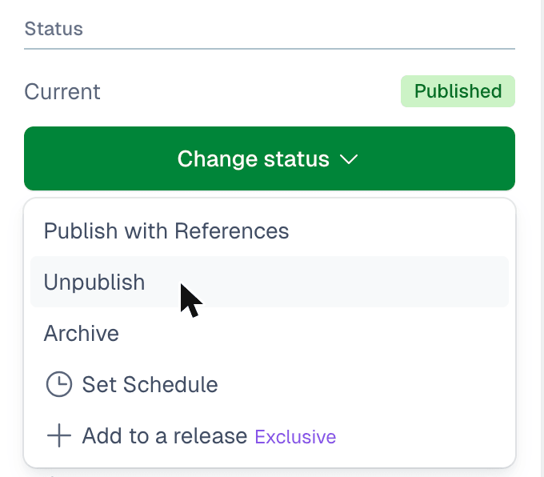
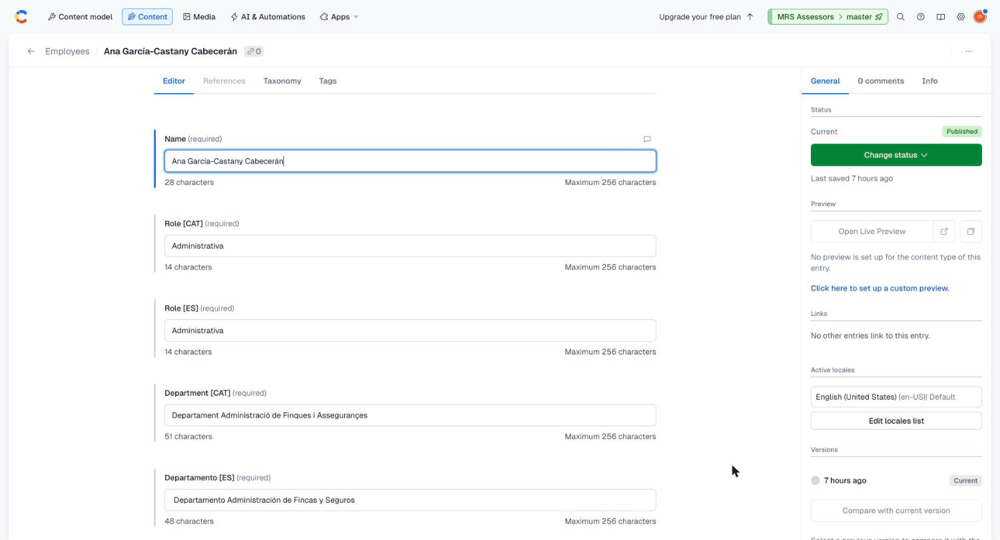

# Antes de empezar

La web de MRS Assessors (www.mrsassessors.com) toma una parte de su contenido de **Contentful**, una aplicación web donde se escribe y se publica ese contenido sin tocar la programación de la web. Esta guía explica todo lo que necesitas para hacerlo.

## Qué puedes cambiar desde Contentful

Desde Contentful se gestionan solo dos cosas:

- **Los artículos** de la sección Notícies (Noticias en la versión en castellano).
- **Los empleados** que aparecen en la sección Equipo, con su cargo, su departamento y su correo electrónico.

Todo lo demás de la web no está en Contentful. Lo encontrarás en el apartado [Lo que no está en Contentful](#lo-que-no-está-en-contentful), al final de esta guía.

## Dos normas que no se pueden saltar

> **Atención**
>
> Todo el despacho entra en Contentful con **la misma cuenta**, y esa cuenta tiene permisos de administrador. Puede cambiar cosas que dejarían la web sin funcionar. Usa solo las secciones **Content** y **Media** que explica esta guía. No entres en **Content model**, **AI & Automations**, **Apps** ni en la configuración (el icono del engranaje, arriba a la derecha). La lista completa está en [Lo que no debes tocar](#lo-que-no-debes-tocar).

> **Atención**
>
> **Todo artículo se publica en catalán y en castellano.** Son dos entradas distintas en Contentful, una por idioma, y se publican siempre juntas. Un artículo en un solo idioma no se publica.

## Palabras que usa esta guía

- **Entrada** (*entry*): cada ficha que guardas en Contentful. Un artículo en catalán es una entrada; su versión en castellano es otra.
- **Recurso** (*asset*): una imagen subida a Contentful.
- **Borrador** (*Draft*): una entrada guardada que todavía no se ve en la web.
- **Publicada** (*Published*): una entrada que ya se ve en la web.
- **Slug**: la parte final de la dirección web de un artículo. Por ejemplo, en `www.mrsassessors.com/es/blogs/nueva-ley-laboral` el slug es `nueva-ley-laboral`.

Contentful está en inglés. En esta guía, los botones y menús aparecen **en negrita** y tal como los verás en pantalla.

# Entrar en Contentful

## Iniciar sesión

1. Abre **https://app.contentful.com** en el navegador.
2. Escribe el correo (**Email**) y la contraseña (**Password**) de la cuenta del despacho y pulsa **Log in**.
3. Si te pide elegir un espacio (*space*), elige **MRS Assessors**.

No uses los botones **Log in via SSO**, **Google** ni **GitHub**: la cuenta del despacho no entra por ahí. En un ordenador compartido, deja sin marcar **Remember me**.

La contraseña **no está en esta guía**. Te la dará el responsable de la web por un canal aparte. No la apuntes en documentos compartidos, no la envíes por correo ni por WhatsApp, y no la guardes en el navegador de un ordenador que usen otras personas.

## Cerrar sesión

Si has usado un ordenador compartido, cierra sesión al terminar: pulsa tu avatar, arriba a la derecha, y después **Log out**.

## La pantalla principal

Arriba verás varias pestañas: **Content model**, **Content**, **Media**, **AI & Automations** y **Apps**. Solo necesitas dos:

- **Content**: los artículos y los empleados.
- **Media**: las imágenes.

En **Content**, la columna de la izquierda tiene un apartado **Content Type**. Pulsa uno de sus nombres para ver solo ese tipo de contenido:

- **MRS Blog** son los artículos.
- **Employees** son los empleados.

Verás también los tipos **Slider**, **Team** y **Generic Images**. Ya no se usan en la web: no los modifiques ni los borres.

# Escribir un artículo

Un artículo son **dos entradas**: una en catalán y otra en castellano. El proceso completo es este:

1. Prepara las imágenes.
2. Crea la entrada en catalán y guárdala como borrador.
3. Crea la entrada en castellano y guárdala como borrador.
4. Repasa las dos con la [lista de comprobación](#antes-de-publicar-lista-de-comprobación).
5. Publica las dos, una detrás de otra.

## 1. Preparar las imágenes

Cada artículo necesita dos imágenes:

- **Thumbnail** (miniatura): la imagen pequeña que aparece junto al título en la lista de Notícies.
- **Feature Image** (imagen principal): la imagen grande que aparece en la página del artículo.

Puede ser la misma imagen para las dos. Las versiones en catalán y castellano usan las mismas imágenes.

Recomendaciones:

- Formato horizontal, en proporción **3:2** (por ejemplo, 1920 × 1280 píxeles).
- En formato JPG, y que no pese más de 1 MB.
- Usa solo imágenes con derechos de uso: propias, de bancos de imágenes libres o compradas.

Para subir una imagen:

1. Ve a **Media** y pulsa **Add asset**, arriba a la derecha.
2. Elige la opción de subir un archivo y selecciona la imagen en tu ordenador.
3. Rellena el campo **Title** con una descripción breve de lo que se ve en la imagen. Por ejemplo, «Firma de un contrato sobre una mesa de despacho».
4. Deja **Description** vacío: la web no lo usa.
5. Pulsa **Publish**, en el panel de la derecha.

En el panel de la derecha, el apartado **Links** indica qué entradas usan la imagen.

> **Importante**
>
> El **Title** de la imagen es el texto que leen las personas con discapacidad visual y los buscadores. Escribe lo que se ve en ella, no «img1» ni el nombre del archivo.

> **Importante**
>
> La imagen tiene que estar **publicada**. Una imagen en borrador hace que la sección Notícies deje de funcionar.

## 2. Crear la entrada en catalán

1. Ve a **Content** y pulsa **Add entry**, arriba a la derecha.
2. En el menú, elige **MRS Blog**. Contentful crea la entrada en ese momento, como borrador (**Draft**).
3. Rellena los campos tal como se explica a continuación.
4. No pulses **Publish** todavía. Contentful guarda los cambios automáticamente mientras escribes («Last saved a few seconds ago»).

Si abandonas una entrada a medias, queda como borrador y no aparece en la web.

### Los campos de un artículo

**Title** (obligatorio). El título del artículo, en el idioma de la entrada.

**Slug** (obligatorio). La dirección del artículo. Contentful lo rellena solo a partir del título. Revísalo y acórtalo siguiendo las [normas del slug](#normas-del-slug).

**Thumbnail** (obligatorio). Pulsa **Add media**, después **Add existing media**, y elige la miniatura que subiste.

**Feature Image** (obligatorio). Igual que la anterior, con la imagen principal.

**Tags** (opcional). Etiquetas que aparecen bajo el título en la lista de Notícies. Escribe cada etiqueta y pulsa Intro. Usa entre una y cuatro, en el idioma de la entrada.

**Method** (obligatorio). El cuerpo del artículo. Consulta [El cuerpo del artículo](#el-cuerpo-del-artículo).

**Text Preview** (opcional, pero recomendado). Un resumen de una o dos frases, de **120 caracteres** como máximo. Aparece bajo el título en la lista de Notícies, y es lo que muestran Google y las redes sociales al compartir el artículo. Si lo dejas vacío, se usan las primeras palabras del cuerpo.

**Language** (obligatorio). El idioma de la entrada: marca **ca** para catalán o **es** para castellano.

> **Atención**
>
> Comprueba **Language** antes de publicar. Si marcas el idioma equivocado, el artículo aparece en la sección Notícies del otro idioma.

### Normas del slug

- Solo minúsculas, números y guiones: sin espacios, acentos, `ñ`, `ç`, `·` ni signos de puntuación.
- Corto y descriptivo: entre tres y seis palabras clave del título.
- Traducido: el slug catalán está en catalán y el castellano, en castellano.
- Único: dos artículos del mismo idioma no pueden tener el mismo slug.
- **No se cambia nunca después de publicar.** Cambiarlo rompe los enlaces que ya se hayan compartido.

| Bien | Mal | Por qué está mal |
| --- | --- | --- |
| `nova-llei-laboral` | `Nova Llei Laboral` | Mayúsculas y espacios |
| `nueva-ley-laboral` | `nueva-ley-laboral-2026-todo-lo-que-necesitas-saber-sobre-la-reforma` | Demasiado largo |
| `exempcio-habitatge-habitual` | `exempció-habitatge-habitual` | Acento |
| `reforma-del-irpf` | `reforma_del_IRPF!` | Guion bajo, mayúsculas y signo |

### El cuerpo del artículo

El campo **Method** es un editor de texto con formato. Puedes usar:

- **Títulos** para dividir el artículo en apartados: en el desplegable **Normal text**, elige **Heading 4** para los apartados y **Heading 5** para los subapartados.
- **Negrita** y *cursiva*.
- Listas con viñetas y listas numeradas.
- Enlaces: selecciona el texto y pulsa el icono del enlace.
- Citas.

No uses el botón **Embed**: la web no muestra imágenes ni otras entradas dentro del cuerpo. Las únicas imágenes del artículo son la miniatura y la imagen principal.

Si copias el texto desde Word, pégalo primero como texto sin formato (en Mac, **⌥⇧⌘V**; en Windows, **Ctrl+Mayús+V**) y aplica después los títulos y la negrita en Contentful. Así no se cuelan estilos extraños.

## 3. Crear la entrada en castellano

Repite el paso anterior con una entrada nueva de **MRS Blog**:

- **Title**, **Slug**, **Tags**, **Method** y **Text Preview** en castellano.
- **Thumbnail** y **Feature Image**: las mismas imágenes que la versión catalana.
- **Language**: `es`.

## 4. Antes de publicar: lista de comprobación

Repasa **las dos entradas**, punto por punto. Una entrada con un campo obligatorio vacío o con una imagen sin publicar puede hacer que deje de verse **toda** la sección Notícies, no solo ese artículo.

- [ ] **Title** escrito, en el idioma correcto.
- [ ] **Slug** escrito y conforme a las [normas del slug](#normas-del-slug).
- [ ] **Language** marcado, y coincide con el idioma del texto.
- [ ] **Thumbnail** y **Feature Image** elegidas, y las dos imágenes están **publicadas** en **Media**, con un **Title** descriptivo.
- [ ] **Method** tiene el texto completo y revisado.
- [ ] **Text Preview** escrito, de 120 caracteres como máximo (recomendado).
- [ ] La otra versión del artículo está igual de completa.

## 5. Publicar

1. Abre la entrada en catalán y pulsa el botón verde **Publish**, en el panel de la derecha. No uses las opciones de la flecha que hay junto al botón.
2. Abre la entrada en castellano y pulsa **Publish**.

Publica las dos en el mismo momento, una detrás de otra, para que el artículo no esté en la web en un solo idioma.

El artículo aparece en la web en un minuto, más o menos:

- En catalán: `www.mrsassessors.com/blogs/` seguido del slug.
- En castellano: `www.mrsassessors.com/es/blogs/` seguido del slug.

Abre las dos direcciones y comprueba que todo se ve bien.

La fecha que muestra la web es la del día en que se **creó** la entrada, no la del día en que se publicó.

# Modificar o retirar un artículo

## Corregir un artículo publicado

1. Busca la entrada en **Content** (puedes escribir parte del título en el buscador).
2. Haz el cambio. La entrada pasa a **Changed**: la web sigue mostrando la versión anterior.
3. Pulsa el botón verde del panel de la derecha para publicar los cambios. El cambio se ve en la web en un minuto, más o menos.

Si corriges algo en un idioma, corrígelo también en el otro.

No cambies nunca el **Slug** de un artículo publicado.

## Retirar un artículo

Para quitar un artículo de la web, **despublícalo** en los dos idiomas:

1. Abre la entrada y pulsa el botón verde **Change status**, en el panel de la derecha.
2. Elige **Unpublish**. No elijas **Archive**.
3. Repite con la entrada del otro idioma.

La entrada queda como borrador y puedes volver a publicarla cuando quieras. **No borres artículos**: lo que se borra no se puede recuperar.

# Mantener el equipo

La sección Equipo de la web muestra a los socios y, debajo, a los empleados agrupados por departamento. Los socios no están en Contentful: consulta [Lo que no está en Contentful](#lo-que-no-está-en-contentful).

Cada empleado es **una sola entrada** con los textos en los dos idiomas.

## Añadir un empleado

1. Ve a **Content**, pulsa **Add entry** y, en el menú, elige **Employees**.
2. Rellena todos los campos. Todos son obligatorios:
   - **Name**: nombre y apellidos.
   - **Role [CAT]** y **Role [ES]**: el cargo, en catalán y en castellano.
   - **Department [CAT]** y **Departamento [ES]**: el departamento, en catalán y en castellano.
   - **Email**: el correo del despacho.
3. Pulsa **Publish**.

> **Atención**
>
> La web agrupa a los empleados por el **texto exacto** del departamento. Copia el nombre de un empleado que ya esté en ese departamento, letra por letra. Con una sola diferencia («Departament fiscal» en lugar de «Departament Fiscal i Comptable») la web crea un departamento nuevo con una sola persona.

Los empleados nuevos aparecen **los primeros** de su departamento. El orden no se puede cambiar desde Contentful.

## Modificar un empleado

Abre su entrada, haz el cambio y pulsa el botón verde del panel de la derecha para publicar los cambios. Si cambias el cargo o el departamento, cámbialo en los dos idiomas.

## Cuando alguien deja el despacho

**Despublica** su entrada (**Change status** y después **Unpublish**). No la borres: si vuelve, basta con publicarla de nuevo.

> **Atención**
>
> No despubliques nunca a **todos** los empleados a la vez. Con la lista vacía, la sección Equipo deja de funcionar.

# Si algo no va bien

**No veo mi cambio en la web.** Espera un par de minutos y recarga la página. Comprueba que la entrada está **Published** y no **Changed** o **Draft**. Si es un artículo, revisa el campo **Language** y busca el artículo en la sección Notícies del otro idioma.

**La sección Notícies (o Equipo) no se ve o da error.** Probablemente hay una entrada con un campo obligatorio vacío o una imagen sin publicar. Repasa lo último que se ha publicado con la [lista de comprobación](#antes-de-publicar-lista-de-comprobación). Si no lo encuentras, avisa enseguida al responsable de la web.

**He borrado algo por error.** Avisa al responsable de la web lo antes posible y explícale qué has borrado.

**He tocado algo en Content model o en la configuración.** No intentes deshacerlo. Avisa al responsable de la web y explícale exactamente qué has cambiado.

# Lo que no debes tocar

La cuenta del despacho puede cambiarlo todo. Estas acciones pueden dejar la web sin funcionar:

- La pestaña **Content model**: no crees, cambies ni borres tipos de contenido ni campos.
- La configuración (el icono del engranaje, arriba a la derecha), en especial **API keys**, **Webhooks**, **Environments**, **Users** y **Roles & permissions**.
- Las pestañas **AI & Automations** y **Apps**.
- El selector verde **MRS Assessors › master**, arriba a la derecha.
- **Archive** en el menú **Change status**: usa **Unpublish**.
- Los tipos de contenido **Slider**, **Team** y **Generic Images**.
- **Borrar** imágenes en **Media**: si alguna entrada las usa, la web deja de funcionar.
- **Borrar** artículos o empleados: despublícalos.
- Cambiar la contraseña o el correo de la cuenta.

# Lo que no está en Contentful

Estas partes de la web forman parte de su programación y no se cambian desde Contentful. Si necesitas cambiar alguna, pídeselo al responsable de la web.

- Las nueve **áreas de práctica** (Laboral, Mercantil, etc.) y sus textos.
- Los **socios**: nombres, cargos y biografías.
- Las **oficinas**: direcciones, mapas y descripciones.
- La página **La Firma**.
- Las imágenes del diseño de la web.
- Los textos fijos: menús, botones, pie de página y política de privacidad.
- El **Portal** de clientes, que es una aplicación aparte.
